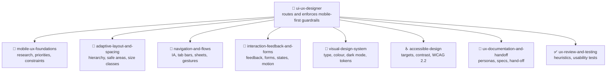

```
██╗   ██╗██╗    ██╗   ██╗██╗  ██╗
██║   ██║██║    ██║   ██║╚██╗██╔╝
██║   ██║██║    ██║   ██║ ╚███╔╝
██║   ██║██║    ██║   ██║ ██╔██╗
╚██████╔╝██║    ╚██████╔╝██╔╝ ██╗
 ╚═════╝ ╚═╝     ╚═════╝ ╚═╝  ╚═╝
██████╗ ███████╗███████╗██╗ ██████╗ ███╗   ██╗███████╗██████╗
██╔══██╗██╔════╝██╔════╝██║██╔════╝ ████╗  ██║██╔════╝██╔══██╗
██║  ██║█████╗  ███████╗██║██║  ███╗██╔██╗ ██║█████╗  ██████╔╝
██║  ██║██╔══╝  ╚════██║██║██║   ██║██║╚██╗██║██╔══╝  ██╔══██╗
██████╔╝███████╗███████║██║╚██████╔╝██║ ╚████║███████╗██║  ██║
╚═════╝ ╚══════╝╚══════╝╚═╝ ╚═════╝ ╚═╝  ╚═══╝╚══════╝╚═╝  ╚═╝
```

<div align="center">

# 📱 UI UX Designer

**Mobile-first UI and UX design skills that also work on tablet and desktop, for designers, developers and their agents.**

[](https://github.com/KinwiseNZ-DevOps/ui-ux-designer/actions/workflows/validate.yml)
[](LICENSE)
[](https://agentskills.io)
[](https://agentskills.io/specification)
[](scripts/skills_tool.py)

</div>

Table of contents:

- [Skills](#skills)
- [How they fit together](#how-they-fit-together)
- [Install](#install)
- [Usage](#usage)
- [Validate](#validate)
- [Layout](#layout)
- [Status and limits](#status-and-limits)

---

> [!IMPORTANT]
> **Principle: design for the smallest screen, the thumb and the slowest moment first, then add space for larger screens without removing function, and never trade accessibility for looks.**

These skills help an agent design, review and document interfaces for phones first, then tablets and desktops. They are grounded in Apple's Human Interface Guidelines, Android and WCAG 2.2 guidance, Nielsen Norman Group research, and the Toptal and Mockflow mobile UX articles, and every number is attributed to its source. They follow the open [Agent Skills](https://agentskills.io/specification) format and work in Claude Code, Codex, Cursor, Copilot, OpenCode or any SKILL.md-compatible agent.

---

<a id="skills"></a>
## 🧩 Skills

<!-- catalogue:begin -->
| Skill | Purpose |
|---|---|
| [`accessible-design`](skills/accessible-design/SKILL.md) | Do not use for general visual styling (visual-design-system), legal compliance claims, or writing accessibility code for a framework. |
| [`adaptive-layout-and-spacing`](skills/adaptive-layout-and-spacing/SKILL.md) | Covers hierarchy, grouping, safe areas, edge-to-edge, size classes and reflow. |
| [`interaction-feedback-and-forms`](skills/interaction-feedback-and-forms/SKILL.md) | Do not use for navigation structure (navigation-and-flows), colour and type (visual-design-system) or a full accessibility audit (accessible-design). |
| [`mobile-ux-foundations`](skills/mobile-ux-foundations/SKILL.md) | Covers research first, one primary action, feature prioritisation, mobile constraints (interruptions, one hand, weak signal) and onboarding. |
| [`navigation-and-flows`](skills/navigation-and-flows/SKILL.md) | Do not use for form fields and messages (interaction-feedback-and-forms), screen spacing (adaptive-layout-and-spacing) or documenting site maps (ux-documentation-and-handoff). |
| [`ui-ux-designer`](skills/ui-ux-designer/SKILL.md) | Routes mobile-first design work (UX principles, layout, navigation, feedback and forms, visual design, accessibility, documentation, review) to focused skills and enforces shared guardrails. |
| [`ux-documentation-and-handoff`](skills/ux-documentation-and-handoff/SKILL.md) | Do not use for choosing the design itself (the design skills), for running usability tests (ux-review-and-testing) or for software documentation such as a README. |
| [`ux-review-and-testing`](skills/ux-review-and-testing/SKILL.md) | Do not use for designing a screen from scratch (the design skills), writing hand-off documents (ux-documentation-and-handoff) or a formal accessibility conformance claim (accessible-design). |
| [`visual-design-system`](skills/visual-design-system/SKILL.md) | Do not use for a full accessibility audit (accessible-design), screen layout (adaptive-layout-and-spacing) or brand strategy and illustration. |
<!-- catalogue:end -->

---

<a id="how-they-fit-together"></a>
## 🗺️ How they fit together



A typical project runs foundations first, then layout and navigation, then interaction and visual design, with accessibility checked throughout, documentation written as decisions settle, and review before release.

---

<a id="install"></a>
## 📦 Install

> [!TIP]
> Install the router skill **plus every sibling skill it links to**; routers reference siblings by relative path.

**Claude Code plugin** (installs the skills and any agent profiles together):

```text
/plugin marketplace add KinwiseNZ-DevOps/ui-ux-designer
/plugin install ui-ux-designer@ui-ux-designer-marketplace
```

Or copy or symlink the `skills/` subfolders you want into your agent's skills directory:

| Agent | Where skills live |
|---|---|
| Claude Code | `~/.claude/skills/` or a project's `.claude/skills/` |
| Codex · Cursor · Copilot · OpenCode · Windsurf | the agent's own SKILL.md discovery path |

---

### Always on

In Claude Code, UI UX Designer loads a short ruleset into sessions in app and UI projects once the plugin is installed. It enforces mobile first, source-attributed target sizes and contrast, full state specs and gesture alternatives. It tells you its state at the start of each session and costs roughly 450 tokens.

| Mode | What it does |
|---|---|
| `on` | The rules apply in every session |
| `auto` (default) | The rules apply only in projects that look relevant: projects with a `pubspec.yaml`, React Native, Expo or Tailwind in `package.json`, `Package.swift` or an `AndroidManifest.xml` |
| `off` | The rules do not load |

- Say **"stop design mode"** to pause it for the current session, and **"start design mode"** to resume.
- Ask Claude to **set the saved mode to on, off or auto**. It writes that word into `~/.claude/.ui-ux-designer.mode`. You can also edit that file yourself, and deleting it returns to the default (`auto`).
- It needs Node on the machine, because the start-up hook runs a small Node script. Without Node the hook quietly does nothing.
- Other agents have no start-up hook here. Paste `skills/ui-ux-designer/references/always-on-rules.md` into that agent's instruction file instead.

### Safety checks

The same hooks run a few checks while you work. Each one only asks, warns or adds a reminder; none changes your files on its own.

| Check | What it does | On by default |
|---|---|---|
| `dangerGuard` | Asks before risky commands: force pushes, `git reset --hard`, `rm -r`, dropping data, `docker compose down -v`, publishing a package | Yes |
| `secretsGuard` | Asks before writing keys, tokens or `.env` files | Yes |
| `packageGuard` | Asks if a package about to be installed does not exist on PyPI, npm or pub.dev, because the name may be invented | Yes |
| `licenseGuard` | Warns after installing an npm or PyPI package with a GPL-family licence | Yes |
| `editSecurity` | Reminds Claude about risky code it just wrote: `eval`, SQL built from strings, unescaped HTML, tokens in SharedPreferences | Yes |
| `promptGuard` | Warns when pasted text looks like it is trying to steer the agent | Yes |
| `verifyReminder` | Tells you at the end of a turn if code changed but no tests, lint or analysis ran | Yes |
| `linkGuard` | Warns about links that return "not found" in Markdown, HTML and JSX files written | No |
| `styleGuard` | Warns when a reply is over 200 words or uses an em or en dash (built for AI Kiwiniser's style) | No |
| `sessionLog` | Writes tool names and file names, never content, to `~/.claude/logs/ui-ux-designer/` | No |
| `autoCommit` | Saves tracked changes as a local commit at the end of a turn. It never pushes | No |

Switch any check with `~/.claude/.ui-ux-designer.features.json`, for example `{"packageGuard": false, "sessionLog": true}`, or ask Claude to write it. The saved mode (on, off or auto) applies to every check. If several of these plugins are installed, each risky action is checked once, not once per plugin.

Privacy: `packageGuard` and `licenseGuard` send package names, and `linkGuard` sends the links it checks, to the public registry or site. Nothing else leaves your machine. Turn those checks off if that is a concern.

<a id="usage"></a>
## 🚀 Usage

> [!TIP]
> **You never need to memorise skill names.** Just describe the problem in plain words; the router picks the right skill automatically. But if you want short, reliable phrases that always work, use these:

**The flow** (this is all most people need):

```text
1. "Plan the core flow for my app"            → foundations, then navigation and flows
2. "Design the settings screen for phone and tablet"   → layout, interaction and visual skills
3. "Review this flow for usability"             → ux-review-and-testing, with accessible-design
```

**Short phrases that trigger each skill:**

| Just say… | What you get | Skill used |
|---|---|---|
| `What should version one include?` | a prioritised core task and research plan | *mobile-ux-foundations* |
| `Make this work on tablet` | adaptive layout per size class | *adaptive-layout-and-spacing* |
| `Tab bar or menu?` | a navigation pattern with reasons | *navigation-and-flows* |
| `Write the error and empty states` | states, messages and form rules | *interaction-feedback-and-forms* |
| `Check the contrast and type` | tokens and contrast ratios | *visual-design-system* |
| `Is this accessible?` | a scoped checklist against WCAG 2.2 AA | *accessible-design* |
| `Write the hand-off notes` | state matrix, copy, specs | *ux-documentation-and-handoff* |
| `Review this for usability` | ranked findings with evidence | *ux-review-and-testing* |

> [!NOTE]
> Skills also trigger on their own when your request matches. In Claude Code you can also invoke one explicitly with `/<skill-name>`, but the plain phrases above are shorter and work across every agent.

---

<a id="validate"></a>
## ✅ Validate

```bash
python scripts/skills_tool.py check
```

Checks: frontmatter, name/folder match, description length and trigger, body under 500 lines, every relative link resolves (including README.md and AGENTS.md), agent profile naming with no more than two profiles per host and exactly one `-workflow` main agent, agent `skills:` entries that exist and no `skills/<name>/SKILL.md` paths in agent bodies, plugin manifests (`.claude-plugin/plugin.json` and `marketplace.json`: required fields, licence matches `LICENSE`, `agents` lists every Claude Code profile, no top-level `agents/` folder), at least 3 eval cases per skill, catalogue freshness, no project-specific terms from `reference-content/strip-terms.txt`, and no em or en dashes in file names or in any text outside `reference-content/`. After the starter skill is deleted it also rejects leftover placeholders and setup-only paths that are tracked by Git or not ignored. Stdlib only, no dependencies.

---

<a id="layout"></a>
## 🗂️ Layout

<details>
<summary>Repository layout</summary>

```
skills/<name>/SKILL.md      one folder per skill (+ references/ where needed)
CHANGELOG.md                release notes; scripts/bump_version.py rolls them
.claude-plugin/             plugin.json and marketplace.json (Claude Code plugin)
plugin.json                 portable plugin manifest for Codex
.agents/plugins/            marketplace.json for Codex
hooks/                      always-on rules and safety checks for Claude Code
evals/cases.jsonl           3+ behavioural cases per skill
evals/triggers.jsonl        triggering tests per skill: obvious, paraphrase, unrelated
quality/evals/              the same cases exported for `claude plugin eval` (generated)
resources/agents/             optional host profiles copied by installer
scripts/install_agents.py     copy optional agent profiles into a project
scripts/skills_tool.py      validate, regenerate catalogue (stdlib only)
.github/workflows/          CI runs `skills_tool.py check` (free on public repos)
AGENTS.md                   agent-facing rules for this repo
SETUP.md                    local checklist; ignored and kept off GitHub
reference-content/          private source material; ignored and kept off GitHub
templates/                  local skill scaffolding; ignored and kept off GitHub
```

</details>

---

<a id="status-and-limits"></a>
## 📌 Status and limits

> [!NOTE]
> - 26 October 2026: guidance is design advice, not a legal accessibility conformance claim; the skills state which criteria were checked.
> - 26 October 2026: one requested article (Medium) returned HTTP 403 and Material Design 3 pages could not be read; Android developer pages stand in for Material guidance.
> - Licensed under MIT (see [LICENSE](LICENSE)).

---

<div align="center">

**⚡ Built on the [Agent Skills](https://agentskills.io) open format · grounded in [Apple HIG](https://developer.apple.com/design/human-interface-guidelines), [WCAG 2.2](https://www.w3.org/TR/WCAG22/) and [Android design](https://developer.android.com/design)**

</div>
